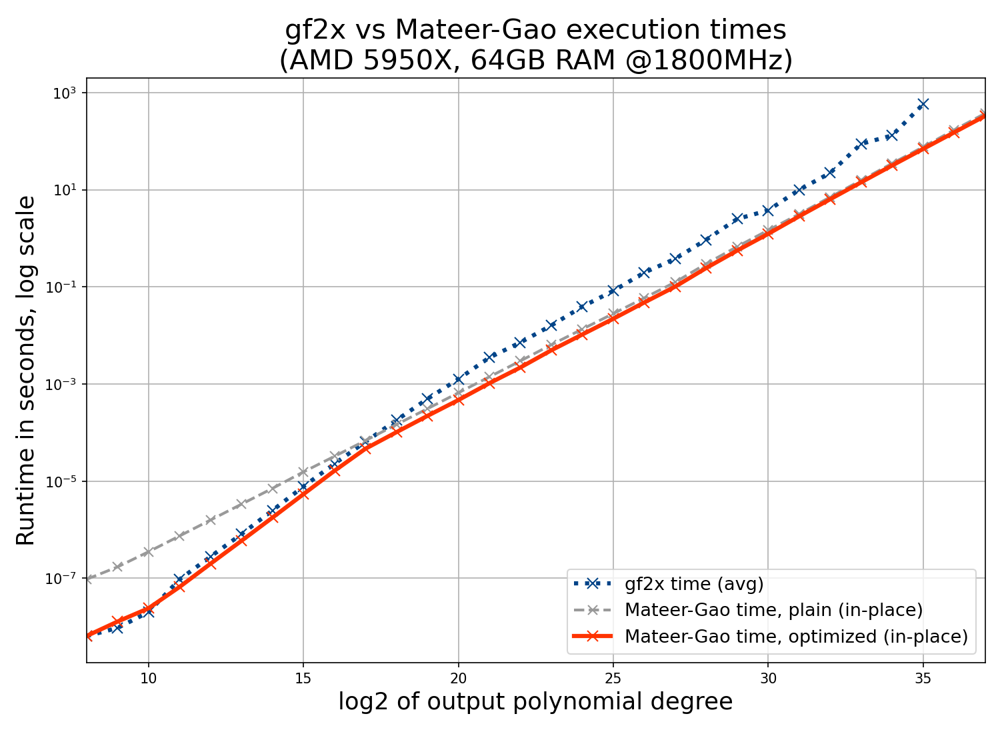
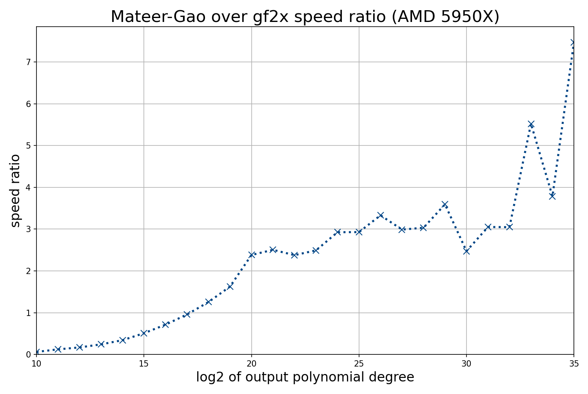

# Additive Discrete Fourier Transforms (DFTs) and application to fast products of binary polynomials
A C++20 implementation of several additive DFT algorithms over $F_2$, and their application to fast binary polynomial multiplication.

The implementation targets the x86_64 architecture with the SSE2, SSE4.1, POPCNT and PCLMULQDQ instruction sets (the build uses `-march=native`, which also enables AVX2, BMI1 and, on CPUs such as Zen 3+ or Intel Ice Lake+, VPCLMULQDQ; see [CPU requirements](#cpu-requirements)). Test programs showcase the different algorithms and test their correctness; see [Programs](#programs). See [CODE_GUIDE.md](CODE_GUIDE.md) for a map of the source code.

Algorithms implemented are: Von zur Gathen - Gerhard algorithm with Cantor bases (also called the Wang-Zhu-Cantor algorithm), and the Mateer-Gao algorithm. Both of them are described in Todd Mateer's Master's Thesis (available at https://tigerprints.clemson.edu/all_dissertations/231/). Reverse algorithms are also implemented.

Truncated versions of these algorithms are available to perform only a part of the DFT computation. Provided with an input polynomial degree $< v = 2^u$, the $v$ first coefficients of the DFT can be computed efficiently (if the underlying finite field has size $w$, the time to compute the truncated DFT is less than $v/w$ times the full DFT time). Truncated reverse transforms have the same complexity and build a polynomial of degree $< v$ that takes the provided values.

A combination of Wang-Zhu-Cantor and Mateer-Gao is also implemented to tackle the case of the computation of $u$ values of a polynomial of degree $d$ where $u$ is much smaller than $d$.

This project is about experimenting with these DFT algorithms. Reference implementations that are close to the high-level description of the algorithms are therefore kept alongside more optimized versions that are more difficult to read. As a result there is some redundancy in the source code.

## Fast product of binary polynomials

Mateer-Gao DFT (and crucially, its truncated implementation) is used to implement fast multiplication of binary polynomials (see [algorithms description](algo_fft_en.md) or https://cr.yp.to/f2mult.html for an outline of the method used). DFTs are used to evaluate the polynomials, then the values obtained for both polynomials are multiplied pointwise, and finally the product is built from the values with an inverse DFT. It is tested and benched against the fastest product implementation known to the author, from library `gf2x`, version 1.3 (https://gitlab.inria.fr/gf2x/gf2x).

Two variants of the product are implemented: 
- the [plain one](#plain-variant) which uses Mateer-Gao at all sizes. It is on par with `gf2x` for an output size of approximate degree $2^{17}$, faster beyond that, and (much) slower for small sizes. 
- an [optimized variant](#optimized-variant) switches to a direct polynomial multiplication at small sizes (as `gf2x` does), and uses other tricks to be a bit faster on large sizes. 

Both have the same interface, give the same results, and use less memory than `gf2x` for large sizes. 

The implementations are tested by multiplying polynomials of degree $2^u - 1$ for values of $u$ s.t. the computations fit into memory. If `gf2x` is available, results are compared with its output. The programs that run these tests and benchmarks are described in [Programs](#programs). 

Each variant is available in an in-place and in an out-of-place version. The in-place variant uses less memory and is slightly faster.

### Optimized variant

**Main files:** `libfft/mg_fused.cpp`, `include/mg_fused.h`, namespace `mg_fused`. Its functions are drop-in replacements for those of `mg.h`.

**Optimizations:**
- **Fused polynomial product**. Outside of initialization/exit operations, the product performs a DFT, then a pointwise product in $K=\mathbb{F}_{2^{64}}$, then an inverse DFT. These three operations implement a polynomial product in $K$; but the DFT is itself recursive and the last operations before the pointwise product are also DFTs of size $R$ = 4, 16 or 256 words. Let $k=\mathbb{F}_R$ be the subfield of $K$ with $R$ elements. The pointwise products are performed on a set of the form $a+k$ for some $a$. Considered together with the pointwise product and the corresponding inverse DFTs, the last stages of the DFT therefore form small polynomial products in $K[X]$ modulo the polynomial $x^R + x + c$, with $c = a^R + a$, which vanishes on $a+k$. The optimized variant does not perform these DFT stages on rows of 16 words (4 words for the smallest sizes): it computes the product of the rows directly.

  **Implementation.** A row product is computed with Karatsuba on carry-less 64x64-bit products that are left unreduced (the reduction is linear over $\mathbb{F}_2$ and done once at the end), then reduced modulo $x^R + x + c$, which costs one multiplication by $c$ per coefficient since $x^R = x + c$. When the CPU supports it (see [CPU requirements](#cpu-requirements)), two rows are processed at once with 256-bit `vpclmulqdq`; otherwise a 128-bit version is used. The direct product beats the chain of DFTs for $R = 4$ and $16$ (by a factor of 2 to 3 on a row) but not for $R = 256$, hence the choice of these row sizes. See `CODE_GUIDE.md` for more details.
- **Base case.** For small products (operands of at most $2^{15}$ bits, i.e. 512 64-bit words, so results of up to $2^{16}$ bits), the DFT is not used at all: the product is computed directly by Karatsuba on carry-less 64x64-bit products (one `pclmulqdq` for operands of at most 64 bits, three for 128 bits, and so on). The operands are processed as arrays of 128-bit digits (2 words) kept in vector registers, which makes the additions and the reassembly of the result cheap; this is the organization of the hand-crafted small products of gf2x. This is faster than the DFT-based product up to $2^{16}$ bits (about 1.15 times faster at $2^{16}$, and more than 10 times faster at $2^{8}$, compared to the DFT-based product of the optimized variant), and slower above (1.2 times at $2^{17}$). This crossover was set by experiment (macro `MG_FUSED_BASE_LOGN` in `mg_fused.cpp`; `MG_FUSED_BASE_LOGN=-1` disables the base case).
- **Taylor decompositions.** The optimized variant also uses faster Taylor decompositions (`include/mg_taylor_opt.h`): two levels of the recursion are merged into one step, and the decomposition of rows of 8 and 16 words is done in AVX2 registers. They are worth 3 to 6% of the time of a product at sizes of $2^{18}$ bits and more (where the DFT is used), and give the same results as the original functions. The plain variant still uses the original ones. See [taylor_merge.md](taylor_merge.md).

The optimized variant is 13 to 15 times faster than the plain one up to $2^{10}$ bits, 2.9 to 11 times faster from $2^{11}$ to $2^{15}$, 2 times faster at $2^{16}$, and the difference then decreases: 1.4 to 1.5 times at $2^{17}$ to $2^{20}$, 1.2 times at $2^{27}$ to $2^{30}$, and 1.1 times from $2^{31}$ on. See [Plain variant](#plain-variant).

**Limitations and origin of the base case.** All the timings in this document are for polynomials of degree $2^{u-1} - 1$, i.e. for sizes that are powers of 2. Unlike `gf2x`, the implementation (both variants) is not optimized for other sizes: the size of the DFTs, and the size of the operands in the base case, are rounded up to a power of 2, so that the time of a product only increases in steps, at the powers of 2, and the product of two polynomials of a size just above a power of 2 takes about as long as a product of the next power of 2. `gf2x` on the other hand has code specialized for many sizes (1 to 9 words, then a choice of Toom-Cook variants for each size), and its time increases more smoothly. The organization of the base case (Karatsuba on 128-bit digits kept in vector registers) was inspired by the hand-crafted small products of `gf2x`.

#### Product computation time results

Experiments on a PC with an AMD Ryzen 9 5950X CPU and 64GB of DDR4 RAM @1800MHz (3600 MT/s), with gf2x 1.3, are summarized below. Results are for the in-place product variant. The code was compiled with gcc 13.3 using `-march=native` (which enables the 256-bit `vpclmulqdq` code path on this CPU). All figures, for both variants and for gf2x, come from one run of the script `benchmark.sh` (the raw numbers are in `2026-10-results_in_place.csv`). Each time is an average over repeated runs, which are timed in batches (a batch lasts at least 1 ms, and runs are repeated until 2 s have elapsed; for the largest sizes, this means a single run), as reading the clock takes about 25 ns, which is not negligible for the smallest sizes. The results of the plain variant are checked against gf2x at every size up to $2^{35}$, and those of the optimized variant up to $2^{25}$ only (`benchmark.sh` limits the comparison to save time). Above $2^{25}$, the results of the optimized variant were therefore not compared with gf2x's. gf2x was not run for $u = 36$ and $37$ (not enough memory); the in-place product of size $2^{36}$ needs 28 GiB and that of size $2^{37}$ needs 56 GiB (see the memory requirements below), which is close to the 64GB available.

|Output log2 size|gf2x (sec.)|optimized Mateer-Gao (sec.)|speed ratio (gf2x time / optimized time)|
|:----:|:----:|:----:|:----:|
|8| 6.451e-09| 6.497e-09| 0.99|
|9| 9.516e-09| 1.288e-08| 0.74|
|10| 2.016e-08| 2.417e-08| 0.83|
|11| 9.491e-08| 6.641e-08| 1.43|
|12| 2.795e-07| 1.999e-07| 1.40|
|13| 8.113e-07| 5.923e-07| 1.37|
|14| 2.503e-06| 1.778e-06| 1.41|
|15| 7.762e-06| 5.392e-06| 1.44|
|16| 2.282e-05| 1.632e-05| 1.40|
|17| 6.455e-05| 4.648e-05| 1.39|
|18| 0.0001793| 0.0001018| 1.76|
|19| 0.0004933| 0.0002203| 2.24|
|20| 0.001261| 0.0004674| 2.70|
|21| 0.003501| 0.001037| 3.38|
|22| 0.00715| 0.002186| 3.27|
|23| 0.01605| 0.004945| 3.25|
|24| 0.03914| 0.01044| 3.75|
|25| 0.08253| 0.02202| 3.75|
|26| 0.1965| 0.04765| 4.12|
|27| 0.3784| 0.1013| 3.74|
|28| 0.9347| 0.2442| 3.83|
|29| 2.497| 0.559| 4.47|
|30| 3.761| 1.234| 3.05|
|31| 9.937| 2.833| 3.51|
|32| 22.08| 6.355| 3.47|
|33| 87.75| 14.19| 6.18|
|34| 130.8| 31.47| 4.16|
|35| 572.3| 68.93| 8.30|
|36| not enough memory| 150.7| -|
|37| not enough memory| 329.1| -|

The graphs also show the plain variant (grey dashed lines), described below. The optimized variant is as fast as gf2x at $2^{8}$ bits and 1.2 to 1.35 times slower at $2^{9}$ and $2^{10}$, where gf2x uses hand-crafted code for each size. It is faster than gf2x from $2^{11}$ on: 1.4 times faster up to $2^{17}$, then 1.8 times at $2^{18}$, 2.2 times at $2^{19}$ and 2.7 times at $2^{20}$; from $2^{21}$ to $2^{35}$ it is 3 to 8 times faster. The gf2x times are irregular for large sizes (the ratio is 3.05 at $2^{30}$ and 6.18 at $2^{33}$, for instance); the Mateer-Gao times, on the other hand, grow regularly, by a factor of about 2.2 each time the size doubles. The product of size $2^{37}$ takes 329 s.

### Plain variant

Main files: `libfft/mg.cpp`, `include/mg.h`.

It is a direct implementation of the Mateer-Gao DFT, kept as a reference, as it is closer to the description of the algorithm (see [CODE_GUIDE.md](CODE_GUIDE.md)). Its memory requirements are the same as those of the optimized variant. Its times, measured as described above in the same run, are compared to those of the optimized variant below:

|Output log2 size|plain Mateer-Gao (sec.)|optimized Mateer-Gao (sec.)|optimized is faster than plain by a factor|
|:----:|:----:|:----:|:----:|
|8| 9.546e-08| 6.497e-09| 14.69|
|9| 1.716e-07| 1.288e-08| 13.33|
|10| 3.524e-07| 2.417e-08| 14.58|
|11| 7.439e-07| 6.641e-08| 11.20|
|12| 1.585e-06| 1.999e-07| 7.93|
|13| 3.357e-06| 5.923e-07| 5.67|
|14| 7.106e-06| 1.778e-06| 4.00|
|15| 1.55e-05| 5.392e-06| 2.87|
|16| 3.245e-05| 1.632e-05| 1.99|
|17| 6.849e-05| 4.648e-05| 1.47|
|18| 0.0001462| 0.0001018| 1.44|
|19| 0.0003095| 0.0002203| 1.40|
|20| 0.000659| 0.0004674| 1.41|
|21| 0.001402| 0.001037| 1.35|
|22| 0.002979| 0.002186| 1.36|
|23| 0.006423| 0.004945| 1.30|
|24| 0.01346| 0.01044| 1.29|
|25| 0.0281| 0.02202| 1.28|
|26| 0.059| 0.04765| 1.24|
|27| 0.1249| 0.1013| 1.23|
|28| 0.2987| 0.2442| 1.22|
|29| 0.6726| 0.559| 1.20|
|30| 1.466| 1.234| 1.19|
|31| 3.145| 2.833| 1.11|
|32| 7.037| 6.355| 1.11|
|33| 15.64| 14.19| 1.10|
|34| 34.7| 31.47| 1.10|
|35| 75.71| 68.93| 1.10|
|36| 169.4| 150.7| 1.12|
|37| 370.8| 329.1| 1.13|

### Memory requirements

The functions of `mg.h` and `mg_fused.h` have the same memory requirements (the base case of the optimized variant, for small products, only uses a few tens of KB of stack).

**Notations.** A product $q = p_1 p_2$ is computed, where the storage of $p_1$ and $p_2$ together uses $n$ bytes (one bit per coefficient). The storage of $q$ is then at most $n$ bytes. Let $m$ be the smallest power of 2 such that $n \le m$, i.e. $2^{k-1} < n \le 2^k = m$. The DFTs are computed on arrays of 64-bit words holding 32 bits of the polynomial each, so the array that holds the DFT of a polynomial of the size of $q$ uses twice the size of $q$, rounded up to a power of 2, i.e. $2m$ bytes.

**Out-of-place variant** (`mg_binary_polynomial_multiply`). The function allocates two arrays of $2m$ bytes (one DFT array per operand), in addition to the buffers that store $p_1$, $p_2$ and $q$ ($n$ bytes for $p_1$ and $p_2$, at most $n$ bytes for $q$). In total, $M = 2n + 4m$ bytes of RAM are needed, with $5m < M \le 6m$.

**In-place variant** (`mg_binary_polynomial_multiply_in_place`). The result $q$ is stored into the buffer of $p_1$, which must be large enough to hold the DFT: $2m$ bytes. The buffer of $p_2$ is modified, and the function allocates an additional array to compute the DFT of $p_2$ (by blocks), of twice the size of $p_2$ rounded up to a power of 2. Exchanging $p_1$ and $p_2$ if necessary, we can assume $\deg(p_2) \le \deg(p_1)$; the size of $p_2$ is then at most $m/2$ bytes. The in-place product therefore needs at most $m/2$ ($p_2$) $+ 2m$ ($p_1$ and $q$) $+ 2 \times m/2$ (additional array) $= 3.5m$ bytes of RAM, which is much less than the out-of-place variant (up to $6m$).

**Example.** The memory used by a product of two polynomials of $2^{u-1}$ bits, whose result has $2^u$ bits (the sizes of the tables above), is, in GiB (1 GiB = $2^{30}$ bytes; here $n = m = 2^{u-3}$ bytes):

|Output log2 size $u$|input ($p_1$ or $p_2$)|result $q$|in-place variant ($3.5m$)|out-of-place variant ($6m$)|
|:----:|:----:|:----:|:----:|:----:|
|32|0.25|0.5|1.75|3|
|33|0.5|1|3.5|6|
|35|2|4|14|24|
|36|4|8|28|48|
|37|8|16|56|96|

For $u = 37$, i.e. a product of two polynomials of degree $2^{36}-1$, each input polynomial is 8 GiB and the result is 16 GiB. With the out-of-place variant, buffers of $2 \times 2 \times 16$ GiB $= 64$ GiB are additionally needed, for a total of 96 GiB. With the in-place variant, the buffer for $p_1$ and the result is $2 \times 16$ GiB $= 32$ GiB, $p_2$ takes 8 GiB, and an additional array of $2 \times 8$ GiB $= 16$ GiB is needed. Overall $8 + 16 + 32 = 56$ GiB of RAM are needed.

### CPU requirements

The polynomial product code uses a fast implementation of multiplication in $\mathrm{GF}(2^{64})$, which is implemented multiple ways in the source, using PCLMULQDQ, POPCNT and SSE intrinsics. The 256-bit `vpclmulqdq` code path is used when the build targets VPCLMULQDQ (see `MG_USE_YMM_CLMUL` in `include/mg_templates.h`); the programs check at startup that the CPU supports the instruction sets the build targets (see [Programs](#programs)).

## Cantor bases for large field sizes

Cantor bases are available for field sizes above $2^{64}$ thanks to the optional use of `Boost::multiprecision` which implements large integers (enabled with the CMake option `-D USE_BOOST=ON`, off by default). With this library, the cantor basis test program tests the construction in finite fields of size up to $2^{2048}$. In theory, truncated Wang-Zhu-Cantor DFT could work in such large fields, however it is not tested and does not work due to overflows in the handling of loop indexes, which are all of type `uint64_t`. There is probably little interest to use these field sizes for truncated DFTs; full DFTs are of course totally unrealistic in these cases.

## Programs

The build produces four programs, described below, in the build directory (see [Build instructions](#build-instructions)). The script `benchmark.sh` runs the product benchmark.

### `product_test`: products of binary polynomials, checked against gf2x

Multiplies random polynomials of degree $2^{u-1} - 1$ (the result has $2^u$ bits) with the Mateer-Gao product, times it, and compares the result with the one of gf2x. It is only built if gf2x is found (see [Build instructions](#build-instructions)). It requires AVX2, BMI1, POPCNT and PCLMULQDQ (and VPCLMULQDQ when the build targets it), and exits with code 2 otherwise; it exits with code 0 if all comparisons succeeded, and 1 on a wrong result or invalid options.

    product_test --sizes LIST [--optimized] [--gf2x-max N] [--no-degree-test] [--help]

* `--sizes LIST` (required): the values of $u$ to test, as a comma-separated list of values or ranges, for instance `8-19,25,30,34`.
* `--optimized`: use the optimized variant of the product (`mg_fused.h`) instead of the plain one (`mg.h`).
* `--gf2x-max N`: time gf2x and compare with it only for $u \le N$ (default: all sizes). gf2x needs more memory than the Mateer-Gao product for large sizes.
* `--no-degree-test`: skip the tests on small degrees that run before the benchmark (Taylor decompositions, and products of all pairs of polynomials of degree $\le 300$, for in-place and out-of-place products of both variants, against a naive product).
* `--help`: print the options.

The in-place product of size $2^u$ bits needs $3.5 \times 2^{u-3}$ bytes of RAM (see the memory requirements above). For each size, the program prints the average time per product of gf2x (if run) and of Mateer-Gao, the ratio of the two, and the result of the comparison. It also prints a line `RESULT u <gf2x time> <Mateer-Gao time>` meant to be parsed by scripts (the gf2x time is 0 if gf2x was not run). Times are in seconds. Runs are repeated, in batches of at least 1 ms, until 2 s have elapsed (this and other settings are constants at the top of `product_test.cpp`). Example:

    product_test --optimized --sizes 10-20

### `product_bench`: timing of the products without gf2x

Built from the same source as `product_test`, without gf2x. It only measures the run times of the Mateer-Gao products, and does not check the results. It is always built, also when gf2x is not available. Output, memory and CPU requirements are as for `product_test`.

    product_bench --sizes LIST [--optimized] [--help]

The options are those of `product_test`, except `--gf2x-max` and `--no-degree-test`, which do not exist (there is no gf2x, and no test).

### `fft_test`: tests and benchmarks of the DFT algorithms

Tests (against direct evaluation or against other algorithms) and benchmarks the DFT algorithms of the Von zur Gathen - Gerhard family and the Mateer-Gao family, in the truncated and reverse versions: VzGG DFT, its reverse, truncated Mateer-Gao (and the VzGG/Mateer-Gao combination), reverse truncated Mateer-Gao, Taylor decomposition, and DFT inversion. It takes no command line argument: the tests to run, the binary field (the word type, which must be `uint32_t` or `uint64_t`), the sizes and the size of the buffer used by the tests (1 GB by default) are constants at the top of `fft_test.cpp`, and the program must be rebuilt after changing them. If `USE_BOOST` is enabled and `Boost::multiprecision` (https://www.boost.org/doc/libs/1_73_0/libs/multiprecision/doc/html/index.html) is found, Cantor bases and DFT objects can be instantiated for all sizes for which large integers are available from this library; the DFT algorithms are not tested in these large fields and most likely do not work correctly in them (see above). It requires SSE2 and PCLMULQDQ, plus AVX2 and VPCLMULQDQ when the build targets them (with `-march=native`, gcc vectorizes the PCLMULQDQ loops of the generic code with 256-bit `vpclmulqdq`), and exits with code 2 otherwise.

    fft_test

### `cantor_basis_test`: consistency checks of the Cantor bases

Builds Cantor bases and checks their consistency (against hard-coded values, and against reference implementations of the field product); with Boost, fields up to $2^{2048}$ are tested. It takes no command line argument and prints the result of each check.

    cantor_basis_test

### `benchmark.sh`: full benchmark of the product

Builds `product_test` (or `product_bench` if gf2x is not found) in a separate build directory and runs the full benchmark of the tables above: plain and optimized variants, and gf2x. It prints a table and writes the logs and a CSV file in a results directory. The largest sizes need a lot of RAM: for them, run it from a text console, on an otherwise idle machine. Without options it tests all sizes from 8 to the largest one that fits in the available RAM (at most 37).

    ./benchmark.sh [-s MIN] [-m MAX] [-g GF2X_MAX] [-o OUT] [-b BUILD_DIR] [-y]

* `-s MIN`, `-m MAX`: smallest size (default 8) and largest size (default: the largest that fits in the available RAM, at most 37).
* `-g GF2X_MAX`: largest size at which gf2x is timed (default 35; gf2x could not be run above 35 with 64GB of RAM). The optimized variant is compared with gf2x only up to size 25, to check its results.
* `-o OUT`: results directory (default `bench-results/<date>`): `plain.log`, `optimized.log`, `results.csv` and `info.txt` (machine description).
* `-b BUILD_DIR`: build directory (default `build-bench`).
* `-y`: do not ask for confirmation.

If `gf2x` was not found at build time, `gf2x` is not timed, and the results of the products are not checked.

## Build instructions
gcc or clang are able to build all targets. 

The build process uses CMake (3.12 or later). There are two kinds of CMake generators, which select the build type (Release, Debug...) differently:

* **Single-configuration generators** (Unix Makefiles, Ninja): the build type is chosen when the project is *configured*, with `CMAKE_BUILD_TYPE`, and a build directory holds only one build type. If it is not given, it defaults to `Release`. For instance, with make, in build directory `$BUILD_DIR` and source directory `$SOURCE_DIR` (add `-G Ninja` to the first command to use Ninja):

      cmake -S $SOURCE_DIR -B $BUILD_DIR -D CMAKE_BUILD_TYPE=Release
      cmake --build $BUILD_DIR --parallel

  The programs are then in `$BUILD_DIR`.

* **Multi-configuration generators** (Visual Studio, Xcode, Ninja Multi-Config, the last one needs CMake 3.17 or later): the build directory is configured once for all build types, `CMAKE_BUILD_TYPE` is ignored, and the build type is chosen when *building*, with `--config`. For instance, with Ninja Multi-Config:

      cmake -S $SOURCE_DIR -B $BUILD_DIR -G "Ninja Multi-Config"
      cmake --build $BUILD_DIR --config Release --parallel

  The programs are in a subdirectory named after the build type, here `$BUILD_DIR/Release/`. Another build type can be built in the same directory with the same command and another `--config` (`Debug` or `RelWithDebInfo`; the programs then go to `$BUILD_DIR/Debug/`, etc.). A build without `--config` uses the first configuration of the generator (`Debug` with Ninja Multi-Config), which is much slower and not suited to benchmarks: do not forget `--config Release`.

Target `product_test` requires a compiled version of `gf2x` for the target platform, searched for in a subdirectory of the source dir named `lib/`, then in `$CUSTOM_LIBS/lib` if an environment variable `CUSTOM_LIBS` is defined, then in the default library directories. If `gf2x` is not found, CMake prints a warning, `product_test` is not built. The other targets (including `product_bench`) are still built. 

Link-time optimization is on by default; disable with `-D LTO=OFF` at configuration.
